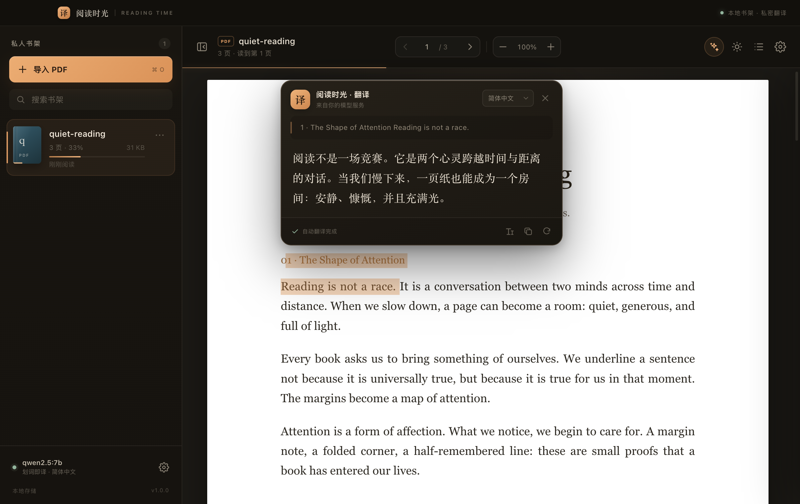
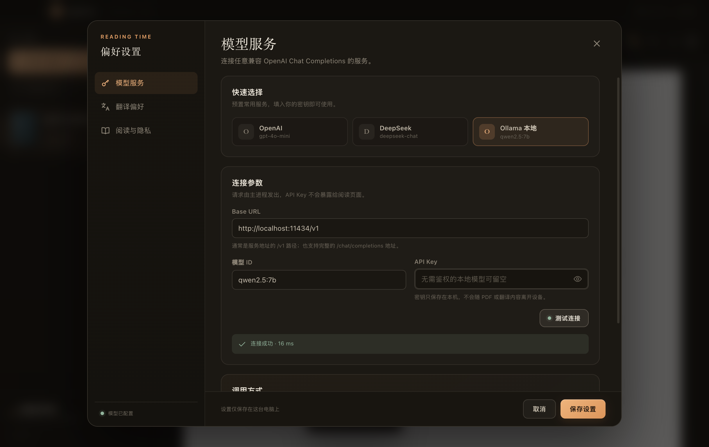
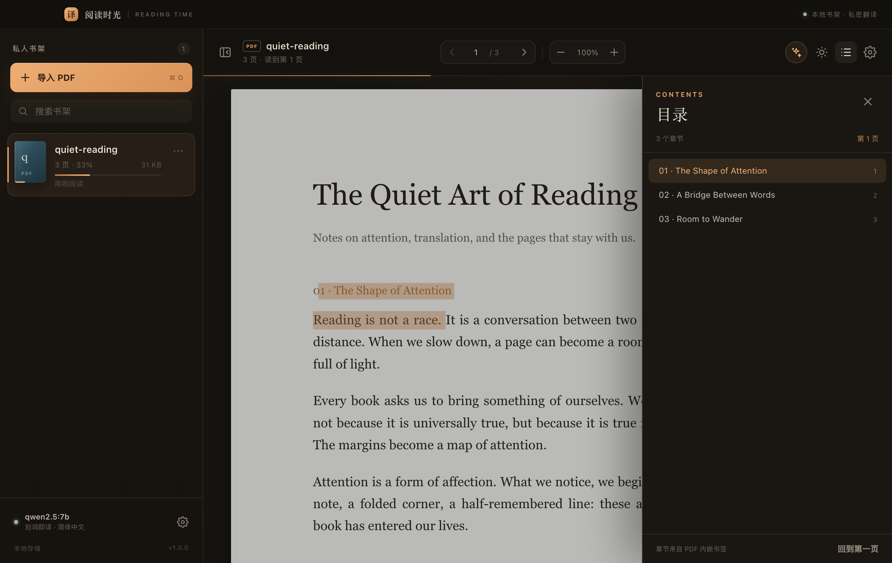

# 阅读时光 ReadingTime

一款以 **划词自动翻译** 为核心的桌面 PDF 阅读器。基于 Electron + React + PDF.js，书架、阅读进度与 API Key 都留在本机。



## 它能做什么

### 核心：选中文字，松开鼠标，译文自动出现

- 在 PDF 文本层中框选任意文字，**松开鼠标即自动发起翻译**，无需再点按钮。
- 译文以浮层形式出现在选区旁，通过 SSE 流式返回，逐字浮现。
- 支持随时切换目标语言、重新翻译、复制译文；译文可打字、可选择、可复制。
- 拖动浮层标题栏可自由移动译文窗口；流式输出和重新翻译会保留手动位置，窗口边界自动限制在可见范围内。
- 浮层里内置 **Aa 外观控制**：宋体 / 黑体 / 楷体、字号、行高都能即时调整，并自动记住。
- 真实鼠标抬起事件驱动（不是模拟点击），同时会处理 PDF 中的分词、换行与连字符。

### 单词与词组释义

- 选中单词或短语时，自动显示结构化词语卡片：**此处用法 → 常用释义 → 原文语境**。
- 此处用法包含当前词性、当前含义和简短的语法/语境解释；常用释义按词性分组。
- 词组作为整体解释，例如“动词短语”“介词短语”，不会机械拆成单词。
- 词形有变化时展示原形；附近语境最多各取前后 400 字符，不上传整份 PDF。
- 同一个词在不同句子里会重新解释；语境不足时明确提示，不猜测此处用法。
- 单词、词组直接展示释义；短句由模型判断后显示原文翻译。
- 释义支持拖动、切换目标语言、调整字体字号、重新查询与复制完整释义。

### 模型服务

- 配置 **Base URL、API Key、模型 ID**，兼容任意 OpenAI Chat Completions 接口。
- 内置 OpenAI / DeepSeek / Ollama 本地三种快捷预设，也可完全自定义。
- 保存前可一键 **测试连接**，401、404、429、超时、本地服务未启动等错误都有可读的中文提示。
- API Key 由 Electron 主进程通过 **系统钥匙串（safeStorage）加密** 保存；密钥不会返回给渲染页面，也不会被写入日志。
- 模型请求由主进程发出，不经过渲染进程，不受 CORS 限制。

### 本地 PDF 书架

- 导入 PDF 时复制到应用专属资料库，不依赖源文件路径。
- 书架检索、重命名、删除、最近阅读、阅读进度百分比。
- 拖拽 PDF 到窗口即可导入；支持一次导入多个文件；基于 SHA-256 去重。
- 支持通过 `⌘O`、原生菜单以及 macOS 文件关联 / 命令行传入 PDF 打开。
- 重启应用自动回到上次打开的书和页码。

### 阅读体验

- PDF.js 高清 Canvas 渲染 + 可选文本层。
- 拉丁文字按 PDF 中的单词位置和宽度对齐选字层，减少内嵌字体、字距和缩放造成的选词偏移。
- 选中原文后支持右键「复制」及 `⌘C`。
- 适宽显示、50%–260% 缩放（支持直接输入百分比，回车或失焦应用，Esc 取消）、`⌘ +/-`、页码跳转、上一页 / 下一页。
- PDF 内嵌 **目录** 解析与跳转。
- 三种阅读主题：原色（浅色界面）、护眼（暖色界面）、夜间（深色界面）；同步切换书架、设置、译文浮层与 PDF 纸面。
- 受密码保护的 PDF 会弹出密码输入框（密码仅用于本机解密，不保存）。
- 页面按视口懒加载，离开视口后释放 Canvas，长文档也不会无限占用内存。

### 其他细节

- 书架与阅读偏好持久化；拖动书架右侧边界调整宽度，双击恢复默认，重启后自动恢复宽度。
- PDF 右侧常驻滚动条：拖拽滚动、点击轨道定位、键盘翻页；页码和阅读进度同步更新。
- 完整键盘操作：`← →`、`PageUp/PageDown`、`⌘B`、`⌘O`、`⌘,`、`Esc`。
- 原生 macOS 应用菜单、隐藏式标题栏、系统钥匙串。
- 无遥测、无广告、无远程页面；翻译时发送选中文字；查词时额外发送附近少量语境到你配置的模型服务。

## 截图

| 书架与阅读 | 模型设置 |
| --- | --- |
|  |  |

| 空白书架 | PDF 目录 |
| --- | --- |
|  |  |

## 快速开始

环境要求：Node.js ≥ 22.13，npm ≥ 10，macOS（当前打包目标）。

```bash
npm install
npm run dev       # 开发模式（Vite HMR + Electron）
```

生产构建：

```bash
npm run build     # 类型检查 + 构建到 out/
npm start         # 预览生产构建
```

生成 macOS 安装包（`release/`）：

```bash
npm run dist
```

产物：

- `release/ReadingTime-1.0.7-arm64.dmg`
- `release/ReadingTime-1.0.7-arm64.zip`
- `release/mac-arm64/阅读时光.app`

> 当前构建使用 ad-hoc 签名，便于本地运行，但未使用 Apple Developer ID 证书、也未做 notarization。通过浏览器下载或拷贝到其他 Mac 时，Gatekeeper 可能要求右键 App →「打开」。如果要对外分发，请配置开发者证书签名并完成 notarization。

## 配置翻译模型

1. 打开任意 PDF，点击工具栏右侧的齿轮，或按 `⌘,`。
2. 在「模型服务」中选择预设或手动填写：
   - **Base URL**：OpenAI 兼容地址，例如 `https://api.openai.com/v1`、`https://api.deepseek.com/v1`、`http://localhost:11434/v1`。
   - **模型 ID**：例如 `gpt-4o-mini`、`deepseek-chat`、`qwen2.5:7b`。
   - **API Key**：本地无鉴权服务可留空；留空保存不会覆盖已经保存的旧 Key。
3. 点击「测试连接」，成功后「保存设置」。
4. 在「翻译偏好」中设置目标语言（可直接输入任意语言名，例如 `繁體中文`、`Français`）与译文外观。

### Ollama 本地示例

```bash
ollama serve
ollama pull qwen2.5:7b
```

在设置中选择「Ollama 本地」，Base URL 填 `http://localhost:11434/v1`，模型 ID 填 `qwen2.5:7b`，API Key 留空。

## 使用说明

- **导入**：左侧「导入 PDF」支持多选；也可以把 PDF 直接拖进窗口。
- **翻译**：用鼠标选中文字后松开。浮层会在选区旁出现；若当前没有配置模型，会直接给出设置入口。
- **字体 / 字号**：点击译文浮层右下角 `Aa` 图标；也可以在设置 →「翻译偏好」中调整，两者会同步保存。
- **目标语言**：译文浮层右上角可直接切换。
- **复制**：原文选区可右键「复制」或按 `⌘C`；复制译文使用浮层右下角复制图标。
- **主题**：工具栏太阳 / 叶子 / 月亮图标循环切换；也可在设置「阅读与隐私」中选择。
- **目录**：工具栏目录图标；没有内嵌书签的 PDF 会明确提示。
- **阅读进度**：自动保存当前页；下次打开从上次位置继续。

### 快捷键

| 快捷键 | 作用 |
| --- | --- |
| `⌘ O` | 导入 PDF |
| `⌘ ,` | 打开设置 |
| `⌘ B` | 展开 / 收起书架 |
| `⌘ +` / `⌘ -` / `⌘ 0` | 放大 / 缩小 / 恢复适宽 |
| `←` / `→`、`PageUp` / `PageDown` | 上一页 / 下一页 |
| `Esc` | 关闭翻译浮层或目录 |

## 数据与隐私

| 数据 | 保存位置 |
| --- | --- |
| PDF 副本 | `~/Library/Application Support/reading-time/library/` |
| 书架索引、阅读进度 | `~/Library/Application Support/reading-time/data/library.json` |
| 模型配置、UI 偏好 | `~/Library/Application Support/reading-time/data/settings.json` |
| API Key | 系统钥匙串加密后的密文，保存在上面的 `settings.json` 中 |
| 渲染缓存 | Electron 默认缓存目录，可在退出后清理 |

- 选中文字会发送到你配置的模型服务；查词时额外附带附近最多 800 字符的原文语境，以判断此处词性和含义。
- 完整 PDF 文件、书架和阅读记录不会被上传；API Key 仅用于向你配置的模型服务鉴权。
- 只有主进程持有明文 API Key；渲染页面只知道「是否已配置」。
- 没有使用任何第三方统计或遥测。

## 项目结构

```text
src/
  main/                 Electron 主进程
    index.ts            窗口、协议、菜单、IPC、生命周期
    library-store.ts    PDF 资料库（复制、去重、索引、进度）
    settings-store.ts   模型配置与 safeStorage 密钥加密
    llm.ts              OpenAI 兼容接口、SSE 流式解析、错误映射
  preload/              contextBridge 安全 API
  renderer/
    index.html          安全策略与 Map 新 API polyfill
    src/
      App.tsx           应用壳、书架、导入、设置调度
      components/       阅读器、页面、翻译浮层、设置、目录等
      lib/pdf.ts        PDF.js 加载、文本层、目录解析、选区提取
  shared/types.ts       主进程 / preload / 渲染层共享类型
tests/
  unit/                 LLM 端点与流式解析单测（Node）
  e2e/                  Playwright Electron 端到端测试
  fixtures/             测试 PDF
scripts/
  copy-pdfjs-assets.mjs 复制 CMaps / 字体 / WASM，并给 PDF.js Worker 打补丁
```

安全设计：

- `contextIsolation: true`、`nodeIntegration: false`、`sandbox: true`。
- 渲染页面通过自定义安全协议 `readingtime://` 加载，开发模式用 Vite 本地服务；禁止任意页面跳转与新窗口。
- CSP 限制脚本、样式、Worker 与网络访问。
- PDF.js 使用本地 Worker、本地 CMaps/标准字体/WASM，不依赖 CDN。
- 模型请求全部在主进程执行，API Key 不下发到页面。

## 测试

```bash
npm run typecheck
npm run test:unit   # Node 24 直接运行 TypeScript 单测
npm run test:e2e    # 构建 + Playwright 驱动真实 Electron
```

E2E 覆盖：

1. 通过真实鼠标拖选 PDF 文本 → 松开 → 自动翻译 → 流式完成 → 复制译文。
2. 配置 Base URL / 模型 / Key → 测试连接 → 保存。
3. 字号、字体调整持久化。
4. PDF 目录跳转与阅读进度恢复。
5. 重命名、删除与空书架状态。
6. 未配置模型与 401 鉴权失败的友好提示。
7. 三种主题切换、原生外观同步、重启恢复、设置取消与保存（无需先配置模型）。
8. macOS 重复打开已有 PDF，以及关闭窗口后再次接收文件。
9. 真实鼠标拖动翻译浮窗、流式/重试位置保持与窗口边界检查。
10. 真实鼠标拖动 PDF 滚动条与侧栏分隔线，检查页码、阅读位置与重启后宽度恢复。
11. 单词、词组、同词异境、短句回退、目标语言、释义复制与无语境/格式错误处理。
12. 设置 `READING_TIME_TEST_PACKAGED=1` 时额外验证 `release/mac-arm64/阅读时光.app` 的启动、PDF 打开与主题切换。
13. 按 PDF 字形坐标真实拖选 `proposal`，验证 100% / 160% 缩放、正反向拖选、原文右键复制与快捷键复制。设置 `READING_TIME_SELECTION_PDF` 为包含示例段落的原书路径时，额外验证其第 58 页；默认使用仓库内带字距调整的测试 PDF。

单测覆盖 OpenAI 兼容端点规范化、翻译提示词、SSE 流式解析、401 映射、连接测试。

## 1.0.7 输入缩放比例

- 工具栏百分比可直接编辑，支持小数和百分号；回车或失焦应用，Esc 取消，无效输入恢复原值，超出范围自动限制在 50%–260%。
- 保留加减按钮、快捷键及缩放时的阅读位置。

## 1.0.6 精简释义卡片

- 移除词语卡片的“词语释义 / 原文翻译”切换栏，直接显示此处用法与常用释义。
- 保留整句、段落翻译和短句自动识别，以及重新查询、目标语言、复制等操作。

## 1.0.5 选词与复制修复

- 修复视觉上选中完整 `proposal`、实际却少选结尾字符的问题：提取拉丁文本时保留单词独立坐标，并用 PDF 字宽校准实际 DOM 选字宽度。
- 文本层使用与 Canvas 一致的小数尺寸，避免页面尺寸取整引入的位置偏移。
- 增加原生右键「复制」，菜单打开时记录选区，避免焦点变化导致复制内容丢失；输入框也支持原生编辑菜单。
- PDF.js Worker 补丁绑定当前固定版本，升级后若补丁位置改变会在构建时明确报错。

## 1.0.4 语境查词

- 单词、词组自动查词，结构化显示当前用法与常用词义；按实际选中位置提取附近语境。
- 明确区分词组与整句；无语境与响应格式异常有清晰提示。
- 更新数据说明：查词会额外发送最多 800 字符的附近语境到已配置的模型服务。

## 1.0.3 阅读交互

- 翻译浮窗支持拖动标题栏移动，也可聚焦标题后用方向键移动；流式输出、重试和字体设置保留手动位置，窗口缩小时自动限制在可见区域。
- PDF 阅读区增加常驻滚动条，支持拖拽、点击定位，以及方向键、PageUp/PageDown、Home/End；横向放大后仍可横向滚动。
- 书架右边界支持拖动调整宽度（220–480px，随窗口大小限制），双击恢复默认；支持键盘调整和宽度记忆。
- 调整书架宽度时保持当前阅读位置；拖动控件不会触发划词翻译。

## 1.0.2 macOS App 入口修复

- 应用标识从 `com.readingtime.app` 改为 `com.readingtime.reader`。
- OmniDock 的点击目标匹配会将 Bundle ID 的最后一段作为别名；旧标识末尾的 `app` 会匹配 macOS 的“App”启动器，导致点击系统图标时错误唤起阅读时光。
- 新标识避免这个冲突。包名仍为 `reading-time`，用户资料库、设置与阅读记录目录不变。
- 安装新版本后退出旧进程，从“应用程序”启动新版；旧安装包仍有旧标识。

## 1.0.1 修复记录

- 未配置翻译模型时，也可正常保存主题与阅读偏好。
- 阅读主题同步应用于整套界面；重启恢复主题，减少启动时的颜色闪烁。
- 系统打开文件改用渲染层完成初始化后的就绪握手，避免启动或重建窗口时丢失 PDF。
- 再次打开已在书架中的 PDF 会切换到对应书籍，不再只提示重复。
- 修正嵌套 PDF 目录的重复节点 ID。
- PDF 文件关联使用 `Alternate` 优先级，作为“打开方式”候选，不主动争夺默认阅读器。

## 已知边界

- **扫描版 PDF（纯图片）没有文本层，无法划词**；需要先用 OCR 工具生成文字层。这是 PDF 格式本身的限制，不是翻译接口问题。
- 翻译质量与响应速度取决于所配置的模型；应用只负责获取选区、发送请求、流式展示。
- 当前仅打包 macOS arm64。其他平台可分别调整 `electron-builder` 配置后构建。
- 加密 PDF 的密码仅用于当前打开会话，不会被存储。
- 尚未实现 PDF 全文搜索、手写标注、OCR。这些都可以在现有 PDF 文本层与资料库结构上继续扩展。

## License

MIT
